# lmcurl

Download with upstream libcurl, parse with lmhtml, and turn asserted results into reports and pictures.

| Mirror parsed HTML, stylesheet, script and image dependencies | Poll until the price is at most 20 USD and stock is positive |
| --- | --- |
| 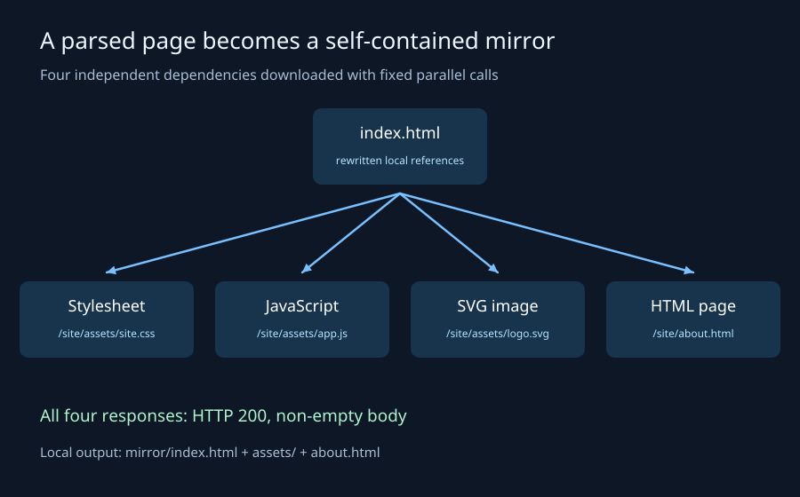 | 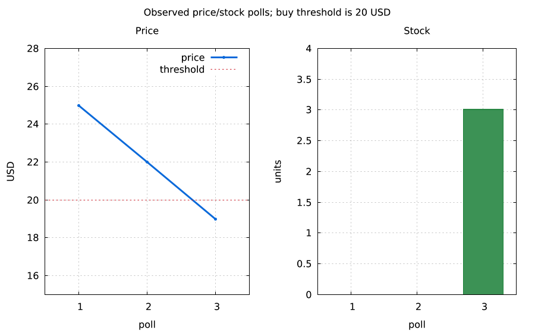 |
| `lmctl https://raw.githubusercontent.com/lmctl-ai/lmcurl/main/examples/web_site_mirror.lms` | `lmctl https://raw.githubusercontent.com/lmctl-ai/lmcurl/main/examples/web_price_watcher.lms` |

| Scrape the product table into a price and stock CSV | Check discovered site links and report missing or denied targets |
| --- | --- |
| 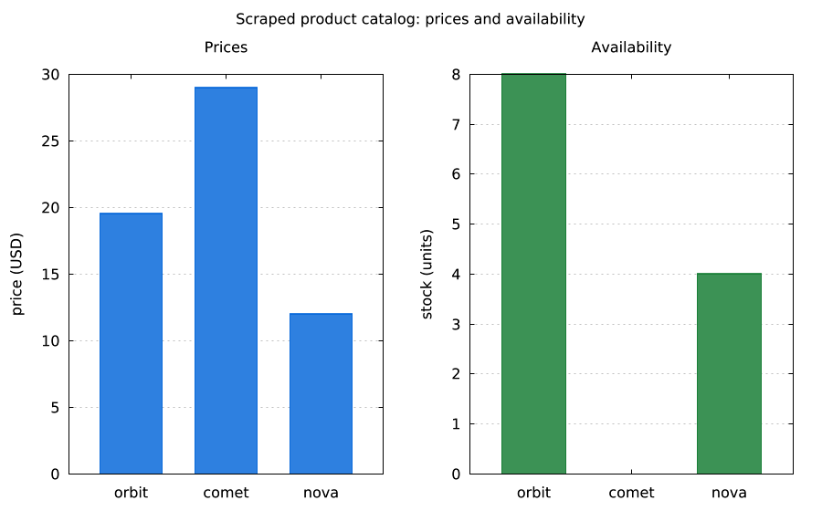 | 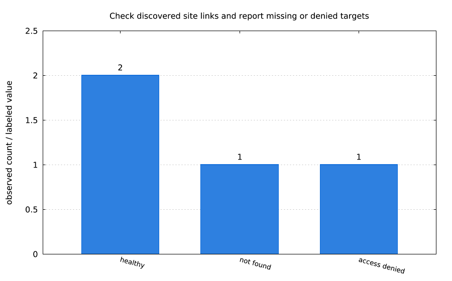 |
| `lmctl https://raw.githubusercontent.com/lmctl-ai/lmcurl/main/examples/web_table_scraper.lms` | `lmctl https://raw.githubusercontent.com/lmctl-ai/lmcurl/main/examples/web_link_checker.lms` |

| A second crawl changes content; a third crawl stays stable | Parse the CSRF field, post credentials and retain the login cookie |
| --- | --- |
| 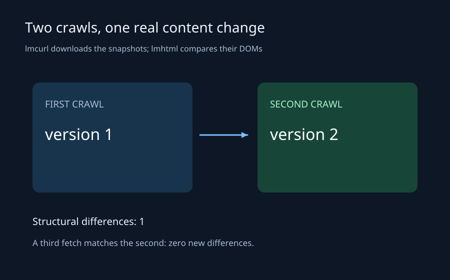 | 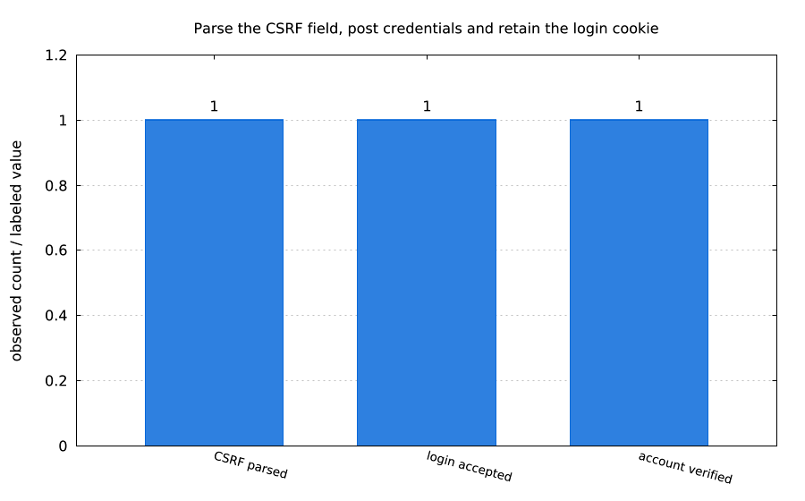 |
| `lmctl https://raw.githubusercontent.com/lmctl-ai/lmcurl/main/examples/web_content_diff.lms` | `lmctl https://raw.githubusercontent.com/lmctl-ai/lmcurl/main/examples/web_login_form.lms` |

```sh
npm install -g @lmctl-ai/lmctl@0.2.420
lmctl https://raw.githubusercontent.com/lmctl-ai/lmcurl/main/examples/web_site_mirror.lms
```

The **16 new downloader/parser stories** run against lmcurl’s native loopback mock site. lmcurl performs HTTP; lmhtml v0.7.4 selects elements and attributes, extracts rows, and compares documents. CSV/text/JSON files pass values between the hosts. The mirror writes `mirror/index.html`, local assets and `about.html`; every story writes `images/<name>.png` and reports under `reports/`. Host installation needs GitHub access once; the example workloads use only localhost.

<details>
<summary>Ten more downloader/parser pictures and runnable captions</summary>

| Parse an XML sitemap, scope its URLs, then crawl them | Read RSS and Atom headlines, publication dates and URLs |
| --- | --- |
| 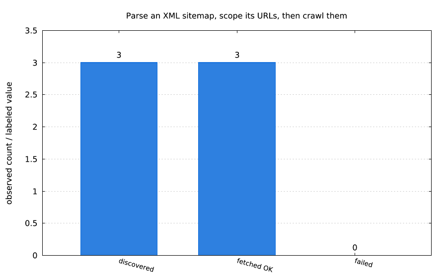 | 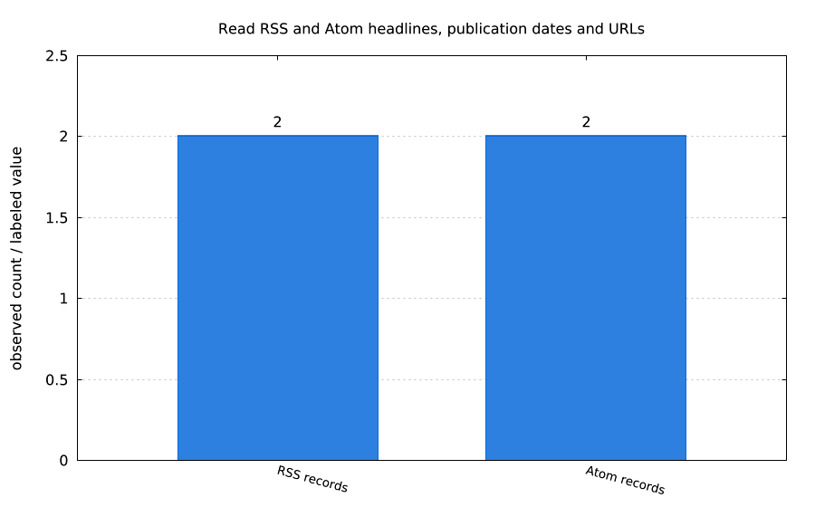 |
| `lmctl https://raw.githubusercontent.com/lmctl-ai/lmcurl/main/examples/web_sitemap_crawler.lms` | `lmctl https://raw.githubusercontent.com/lmctl-ai/lmcurl/main/examples/web_feed_reader.lms` |

| Follow parsed next links to collect nine articles | SEO audit: metadata, headings and image alternatives |
| --- | --- |
| 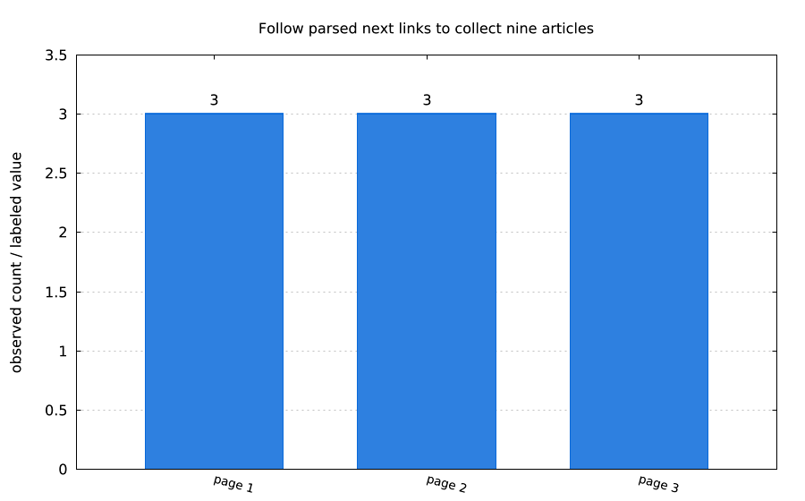 | 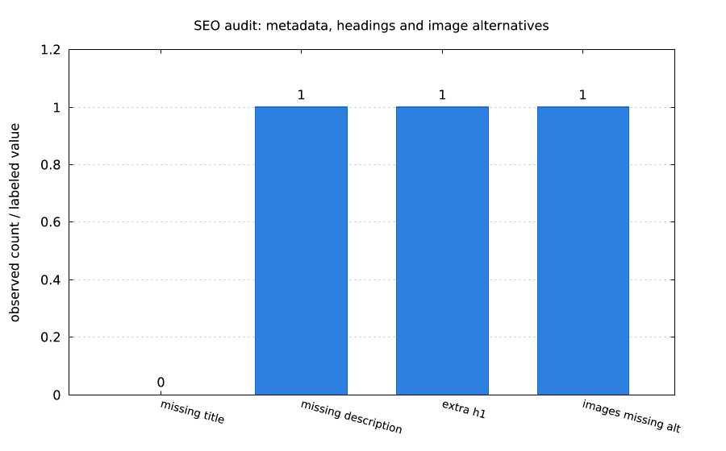 |
| `lmctl https://raw.githubusercontent.com/lmctl-ai/lmcurl/main/examples/web_pagination.lms` | `lmctl https://raw.githubusercontent.com/lmctl-ai/lmcurl/main/examples/web_seo_audit.lms` |

| Find broken image URLs and follow every redirect hop | Compare each product SKU, price and stock with the API |
| --- | --- |
| 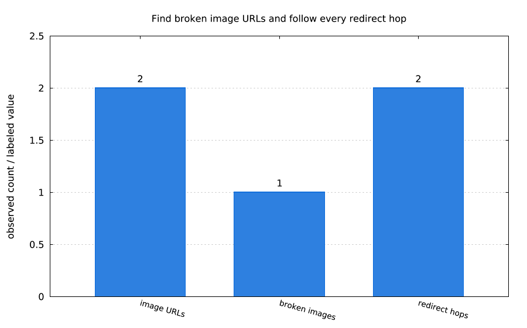 | 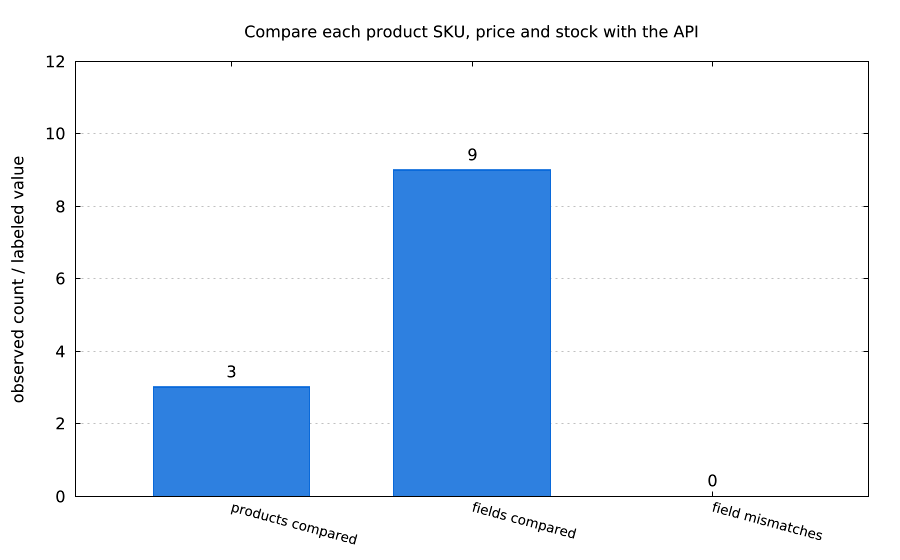 |
| `lmctl https://raw.githubusercontent.com/lmctl-ai/lmcurl/main/examples/web_image_redirect_audit.lms` | `lmctl https://raw.githubusercontent.com/lmctl-ai/lmcurl/main/examples/web_api_html_consistency.lms` |

| Scan basic labels, image alternatives and empty controls | Extract and inspect JSON-LD and OpenGraph fields |
| --- | --- |
| 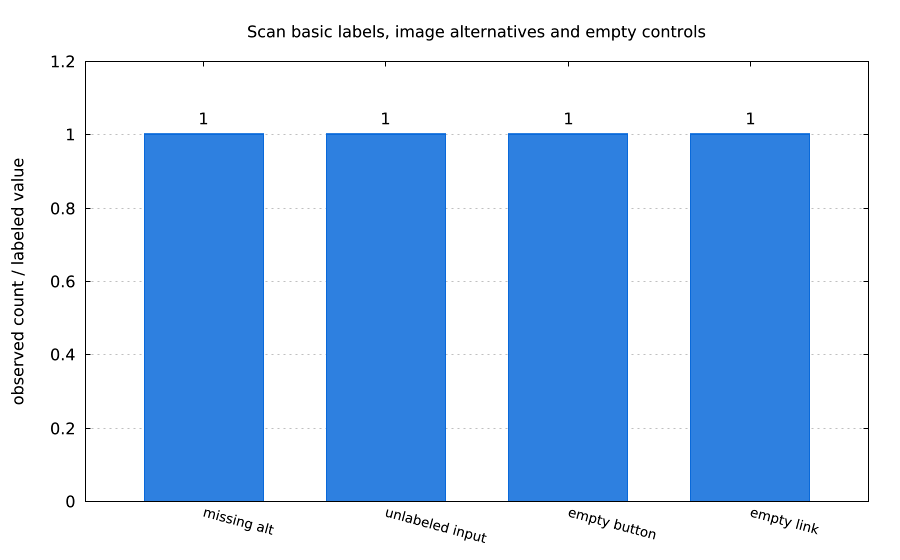 | 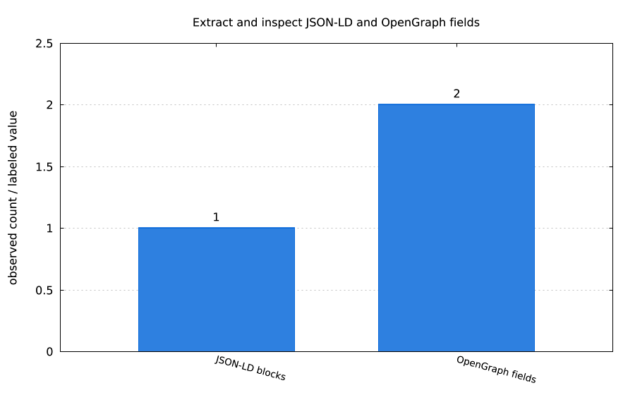 |
| `lmctl https://raw.githubusercontent.com/lmctl-ai/lmcurl/main/examples/web_accessibility_scan.lms` | `lmctl https://raw.githubusercontent.com/lmctl-ai/lmcurl/main/examples/web_metadata_extractor.lms` |

| Inventory form actions, methods and named controls | Respect robots exclusions and wait between allowed requests |
| --- | --- |
| 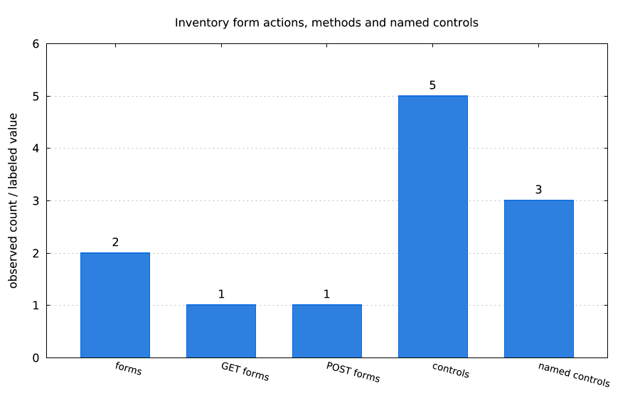 | 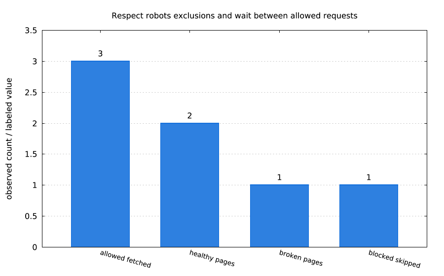 |
| `lmctl https://raw.githubusercontent.com/lmctl-ai/lmcurl/main/examples/web_form_inventory.lms` | `lmctl https://raw.githubusercontent.com/lmctl-ai/lmcurl/main/examples/web_robots_crawler.lms` |

</details>

Each new example records its actual requests in `data/web-requests.jsonl`, writes `reports/<name>-cost.json` with a zero-price loopback table and the $0.02/$0.25 caps, and prints `estimated cost: $0.0000`. No cloud/LLM calls or credentials are required. Login credentials and the CSRF value are public fixtures; cookie values stay inside one downloader process.

Independent downloads use fixed `parallel([download(...), ...])` call lists. The shared helper can be reused when dynamic fan-out is available. `Mock.serve(ready_file, stop_file, timeout_ms)` publishes readiness atomically and shuts down on the stop signal or a deadline (maximum 120 seconds); the examples use 60 seconds. Requests have five-second timeouts and a 1 MiB response limit.

The robots example implements the fixture’s `User-agent: *`, `Disallow` prefixes and `Crawl-delay`, measures its delay and proves that private URLs were not requested. The accessibility example is a basic smell scan. XML/feed examples extract unprefixed sitemap/RSS/Atom fields with the HTML parser; RSS URLs use permalink GUIDs. These are bounded recipes rather than complete robots, accessibility or XML validators.

## All 48 examples

| Story | Run from an empty directory |
| --- | --- |
| A user record through its complete lifecycle | `lmctl https://raw.githubusercontent.com/lmctl-ai/lmcurl/main/examples/rest_crud.lms` |
| Login capture unlocks a protected resource | `lmctl https://raw.githubusercontent.com/lmctl-ai/lmcurl/main/examples/login_session.lms` |
| A session keeps cookies across requests | `lmctl https://raw.githubusercontent.com/lmctl-ai/lmcurl/main/examples/cookie_jar.lms` |
| Anonymous and authenticated access | `lmctl https://raw.githubusercontent.com/lmctl-ai/lmcurl/main/examples/auth_boundary.lms` |
| Following a bounded redirect chain | `lmctl https://raw.githubusercontent.com/lmctl-ai/lmcurl/main/examples/redirect_chain.lms` |
| Recovery after three transient failures | `lmctl https://raw.githubusercontent.com/lmctl-ai/lmcurl/main/examples/retry_recovery.lms` |
| Poll assertions until the service is ready | `lmctl https://raw.githubusercontent.com/lmctl-ai/lmcurl/main/examples/poll_readiness.lms` |
| Required fields and collection bounds | `lmctl https://raw.githubusercontent.com/lmctl-ai/lmcurl/main/examples/json_contract.lms` |
| Typed JSONPath projections and predicates | `lmctl https://raw.githubusercontent.com/lmctl-ai/lmcurl/main/examples/jsonpath_projection.lms` |
| XPath checks on an XML catalog | `lmctl https://raw.githubusercontent.com/lmctl-ai/lmcurl/main/examples/xml_catalog.lms` |
| Extracting HTML with XPath | `lmctl https://raw.githubusercontent.com/lmctl-ai/lmcurl/main/examples/html_extract.lms` |
| Three CSV rows exercise one request template | `lmctl https://raw.githubusercontent.com/lmctl-ai/lmcurl/main/examples/csv_cases.lms` |
| JSON data drives a reusable request | `lmctl https://raw.githubusercontent.com/lmctl-ai/lmcurl/main/examples/json_cases.lms` |
| Select only the smoke contract | `lmctl https://raw.githubusercontent.com/lmctl-ai/lmcurl/main/examples/tag_filter.lms` |
| Independent checks run concurrently | `lmctl https://raw.githubusercontent.com/lmctl-ai/lmcurl/main/examples/parallel_checks.lms` |
| A failed contract produces actionable reports | `lmctl https://raw.githubusercontent.com/lmctl-ai/lmcurl/main/examples/failure_reports.lms` |
| Setup runs before protected checks | `lmctl https://raw.githubusercontent.com/lmctl-ai/lmcurl/main/examples/suite_lifecycle.lms` |
| Form encoding and multipart upload | `lmctl https://raw.githubusercontent.com/lmctl-ai/lmcurl/main/examples/form_and_upload.lms` |
| Event-stream data stays bounded and inspectable | `lmctl https://raw.githubusercontent.com/lmctl-ai/lmcurl/main/examples/sse_events.lms` |
| Compressed responses are decoded before queries | `lmctl https://raw.githubusercontent.com/lmctl-ai/lmcurl/main/examples/compression.lms` |
| Oversized responses fail their contract | `lmctl https://raw.githubusercontent.com/lmctl-ai/lmcurl/main/examples/response_limits.lms` |
| Snapshots detect response regressions | `lmctl https://raw.githubusercontent.com/lmctl-ai/lmcurl/main/examples/snapshot_contract.lms` |
| Check a JSON OpenAPI response contract | `lmctl https://raw.githubusercontent.com/lmctl-ai/lmcurl/main/examples/openapi_contract.lms` |
| Virtual users and latency thresholds | `lmctl https://raw.githubusercontent.com/lmctl-ai/lmcurl/main/examples/load_latency.lms` |
| A prompt regression is an ordinary assertion | `lmctl https://raw.githubusercontent.com/lmctl-ai/lmcurl/main/examples/llm_prompt.lms` |
| Both OpenAI and Ollama streaming fixtures | `lmctl https://raw.githubusercontent.com/lmctl-ai/lmcurl/main/examples/llm_streams.lms` |
| Sampling reports measured prompt pass rates | `lmctl https://raw.githubusercontent.com/lmctl-ai/lmcurl/main/examples/llm_sampling.lms` |
| A model matrix compares one prompt side by side | `lmctl https://raw.githubusercontent.com/lmctl-ai/lmcurl/main/examples/llm_matrix.lms` |
| Recorded completions replay without credentials | `lmctl https://raw.githubusercontent.com/lmctl-ai/lmcurl/main/examples/llm_replay.lms` |
| Structured completions have schema contracts | `lmctl https://raw.githubusercontent.com/lmctl-ai/lmcurl/main/examples/llm_json.lms` |
| Where a delayed response spends its time | `lmctl https://raw.githubusercontent.com/lmctl-ai/lmcurl/main/examples/timing_breakdown.lms` |
| Credentials stay out of saved artifacts | `lmctl https://raw.githubusercontent.com/lmctl-ai/lmcurl/main/examples/secret_redaction.lms` |
| Check discovered site links and report missing or denied targets | `lmctl https://raw.githubusercontent.com/lmctl-ai/lmcurl/main/examples/web_link_checker.lms` |
| Parse an XML sitemap, scope its URLs, then crawl them | `lmctl https://raw.githubusercontent.com/lmctl-ai/lmcurl/main/examples/web_sitemap_crawler.lms` |
| Read RSS and Atom headlines, publication dates and URLs | `lmctl https://raw.githubusercontent.com/lmctl-ai/lmcurl/main/examples/web_feed_reader.lms` |
| Scrape the product table into a price and stock CSV | `lmctl https://raw.githubusercontent.com/lmctl-ai/lmcurl/main/examples/web_table_scraper.lms` |
| Poll until the price is at most 20 USD and stock is positive | `lmctl https://raw.githubusercontent.com/lmctl-ai/lmcurl/main/examples/web_price_watcher.lms` |
| Parse the CSRF field, post credentials and retain the login cookie | `lmctl https://raw.githubusercontent.com/lmctl-ai/lmcurl/main/examples/web_login_form.lms` |
| Follow parsed next links to collect nine articles | `lmctl https://raw.githubusercontent.com/lmctl-ai/lmcurl/main/examples/web_pagination.lms` |
| Mirror parsed HTML, stylesheet, script and image dependencies | `lmctl https://raw.githubusercontent.com/lmctl-ai/lmcurl/main/examples/web_site_mirror.lms` |
| SEO audit: metadata, headings and image alternatives | `lmctl https://raw.githubusercontent.com/lmctl-ai/lmcurl/main/examples/web_seo_audit.lms` |
| Find broken image URLs and follow every redirect hop | `lmctl https://raw.githubusercontent.com/lmctl-ai/lmcurl/main/examples/web_image_redirect_audit.lms` |
| Compare each product SKU, price and stock with the API | `lmctl https://raw.githubusercontent.com/lmctl-ai/lmcurl/main/examples/web_api_html_consistency.lms` |
| A second crawl changes content; a third crawl stays stable | `lmctl https://raw.githubusercontent.com/lmctl-ai/lmcurl/main/examples/web_content_diff.lms` |
| Scan basic labels, image alternatives and empty controls | `lmctl https://raw.githubusercontent.com/lmctl-ai/lmcurl/main/examples/web_accessibility_scan.lms` |
| Extract and inspect JSON-LD and OpenGraph fields | `lmctl https://raw.githubusercontent.com/lmctl-ai/lmcurl/main/examples/web_metadata_extractor.lms` |
| Inventory form actions, methods and named controls | `lmctl https://raw.githubusercontent.com/lmctl-ai/lmcurl/main/examples/web_form_inventory.lms` |
| Respect robots exclusions and wait between allowed requests | `lmctl https://raw.githubusercontent.com/lmctl-ai/lmcurl/main/examples/web_robots_crawler.lms` |

## Host API and limits

Typed `Session`, `Request`, `Response`, `Query`, `Suite`, `Test`, `Report`, `LoadResult`, `Provider`, `Chat`, `Result`, `Sample` and `Matrix` objects cover headers/bodies/forms/uploads, cookies/auth, redirects, retries, polling, JSONPath/XPath, JSON Schema/OpenAPI response checks, snapshots and bounded load checks. Reports support console, TAP, JUnit, JSON, CSV and HTML. See [the generated schema](schema/lmcurl.dsl.json) and `lmcurl --dsl-signatures` (259 lines including standard functions and contexts).

`LMCURL_MAX_MEMORY_MB` defaults to 4096 MiB. Responses, parsers, object counts and concurrency have additional hard limits. Regex assertions use POSIX ERE without backreferences/lookarounds, at most 8192 text bytes and 256 pattern bytes; common `\d`, `\w` and `\s` escapes are translated. Streaming buffers a bounded response before assertions. `Request.proxy("")` explicitly disables environment proxies, as used by the offline download helper. `Request.allow_error(true)` makes `Request.send()` return a `Response` with `status() == 0` and a redacted `error()` string on transport failure instead of throwing, so batch jobs can record failure receipts and continue in one process (the default `allow_error(false)` still throws).

The LLM layer supports OpenRouter, DeepSeek and Ollama, streaming/tool assembly, JSON mode, sampling, model matrices and cassette replay. Live calls require `LMCURL_LIVE=1` and are forbidden in CI. Pre-call cost reservations default to $0.02, with a hard $0.25 process ceiling. Known key values and credential-shaped strings are redacted from exported artifacts. The original [live evidence](evidence/live-llm-v010.json) records four provider paths with total estimated cost $0.00000360, excluding Ollama subscription/infrastructure costs; its cloud Ollama call exhausted the small output allowance without visible text. No live calls were needed for these new examples.

Linux x64 and ARM64 are full native hosts requiring glibc >=2.35; application libraries are static and permissive. macOS x64/ARM64 and Windows x64 are explicit metadata stubs and reject DSL execution.

## Build and verify

```sh
bash scripts/sync-deps.sh
cmake -S . -B build -G Ninja -DCMAKE_BUILD_TYPE=Release
cmake --build build --parallel 2
BUILD_DIR=build LMCURL_TEST_NETWORK=1 bash test.sh
```

The local gate checks pins, exact schema/signatures/notices, dynamic glibc linkage, native safety regressions, parser integration, mock lifecycle and memory limits. With renderers available it executes all 48 stories and validates their images and new cost ledgers; otherwise it skips rendering loudly and checks committed images. `scripts/test-autorun.py --only-new` verifies the 16 new public URLs with a fresh cache and all four hosts removed from PATH.

[Releases and SHA256SUMS](https://github.com/lmctl-ai/lmcurl/releases) · [Independent review](docs/REVIEW.md) · [Durable memory](durable-memory/index.md) · [Third-party notices](THIRD_PARTY_NOTICES) · [MIT license](LICENSE).

[v0.1.1 release](https://github.com/lmctl-ai/lmcurl/releases/tag/v0.1.1): five executables and SHA256SUMS. [All 16 new public autoruns](evidence/autorun-v011.json) passed with a fresh tool cache and all four hosts removed from PATH; 46 loopback requests, estimated cost $0.0000. [Published asset hashes](evidence/release-v011.json) and [local validation](evidence/local-v011.json) are recorded. The parser compatibility fix is [lmhtml v0.7.4](https://github.com/lmctl-ai/lmhtml/releases/tag/v0.7.4).
