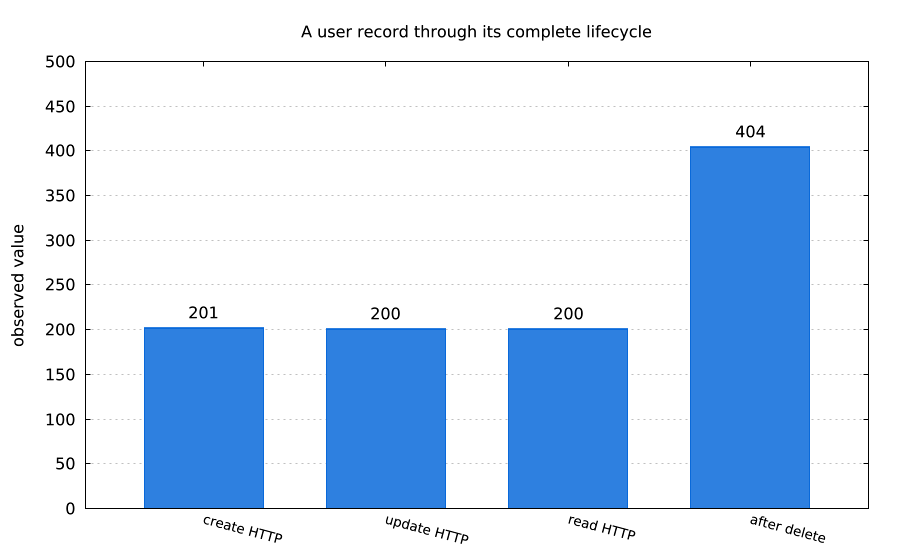
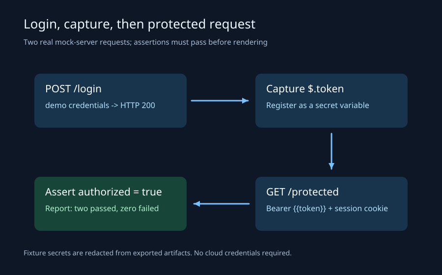
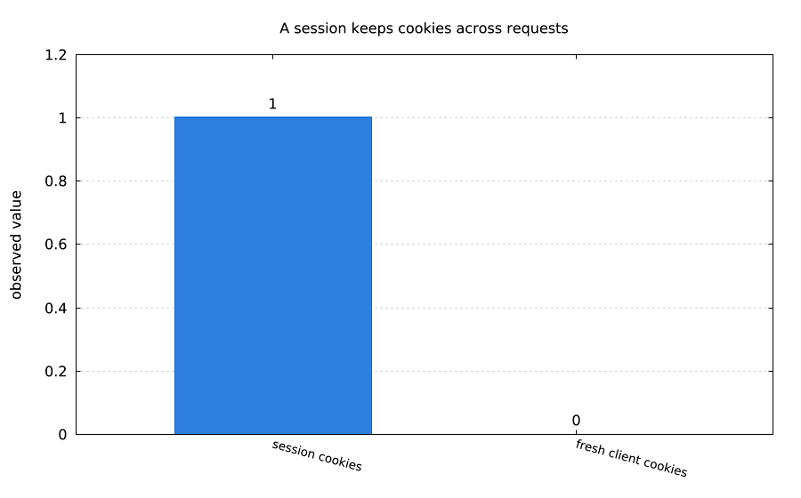
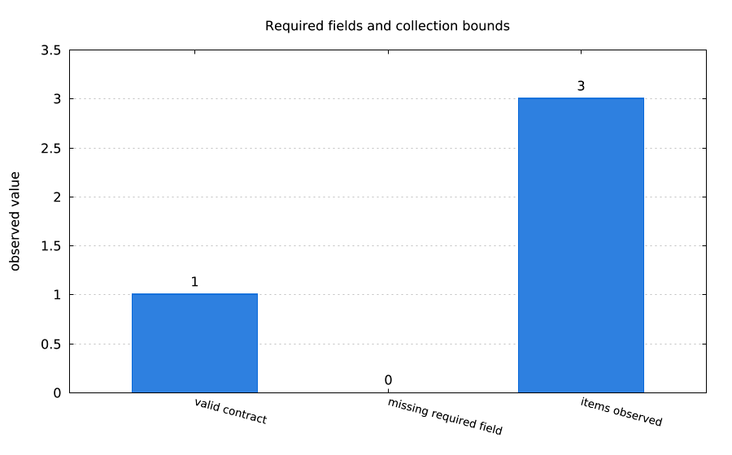
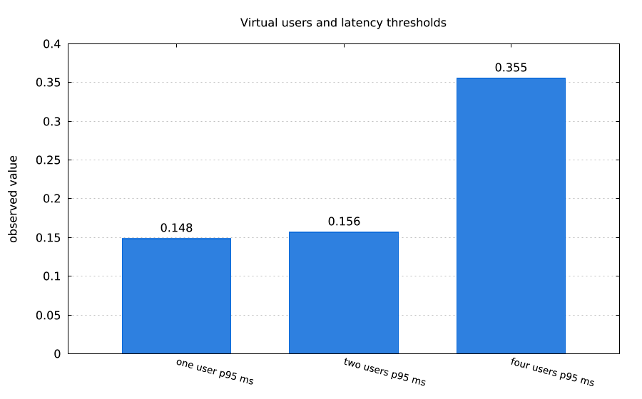
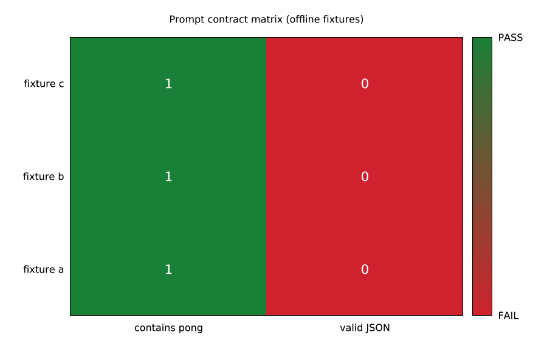

# lmcurl

Scriptable HTTP, REST and LLM checks in one MIT lmscript host. The examples use an in-process mock server, so the gallery is reproducible without credentials.

| Picture | Story and autorun |
| --- | --- |
|  | [REST CRUD](examples/rest_crud.lms): create, update and delete a user. `lmctl autorun https://raw.githubusercontent.com/lmctl-ai/lmcurl/main/examples/rest_crud.lms` |
|  | [Login session](examples/login_session.lms): request-flow diagram showing captured authentication and protected access. `lmctl autorun https://raw.githubusercontent.com/lmctl-ai/lmcurl/main/examples/login_session.lms` |
|  | [Cookie jar](examples/cookie_jar.lms): preserve cookies between requests. `lmctl autorun https://raw.githubusercontent.com/lmctl-ai/lmcurl/main/examples/cookie_jar.lms` |
|  | [JSON Schema](examples/json_contract.lms): validate a response contract. `lmctl autorun https://raw.githubusercontent.com/lmctl-ai/lmcurl/main/examples/json_contract.lms` |
|  | [Load latency](examples/load_latency.lms): bounded concurrent requests and p95 timing. `lmctl autorun https://raw.githubusercontent.com/lmctl-ai/lmcurl/main/examples/load_latency.lms` |
|  | [LLM matrix](examples/llm_matrix.lms): compare prompt contracts across three mock models. `lmctl autorun https://raw.githubusercontent.com/lmctl-ai/lmcurl/main/examples/llm_matrix.lms` |

The remaining gallery captions are directly runnable from an empty directory:

| Example | Autorun |
| --- | --- |
| auth_boundary | `lmctl autorun https://raw.githubusercontent.com/lmctl-ai/lmcurl/main/examples/auth_boundary.lms` |
| cookie_jar | `lmctl autorun https://raw.githubusercontent.com/lmctl-ai/lmcurl/main/examples/cookie_jar.lms` |
| compression | `lmctl autorun https://raw.githubusercontent.com/lmctl-ai/lmcurl/main/examples/compression.lms` |
| csv_cases | `lmctl autorun https://raw.githubusercontent.com/lmctl-ai/lmcurl/main/examples/csv_cases.lms` |
| failure_reports | `lmctl autorun https://raw.githubusercontent.com/lmctl-ai/lmcurl/main/examples/failure_reports.lms` |
| form_and_upload | `lmctl autorun https://raw.githubusercontent.com/lmctl-ai/lmcurl/main/examples/form_and_upload.lms` |
| html_extract | `lmctl autorun https://raw.githubusercontent.com/lmctl-ai/lmcurl/main/examples/html_extract.lms` |
| json_cases | `lmctl autorun https://raw.githubusercontent.com/lmctl-ai/lmcurl/main/examples/json_cases.lms` |
| jsonpath_projection | `lmctl autorun https://raw.githubusercontent.com/lmctl-ai/lmcurl/main/examples/jsonpath_projection.lms` |
| llm_json | `lmctl autorun https://raw.githubusercontent.com/lmctl-ai/lmcurl/main/examples/llm_json.lms` |
| llm_prompt | `lmctl autorun https://raw.githubusercontent.com/lmctl-ai/lmcurl/main/examples/llm_prompt.lms` |
| llm_replay | `lmctl autorun https://raw.githubusercontent.com/lmctl-ai/lmcurl/main/examples/llm_replay.lms` |
| llm_sampling | `lmctl autorun https://raw.githubusercontent.com/lmctl-ai/lmcurl/main/examples/llm_sampling.lms` |
| llm_streams | `lmctl autorun https://raw.githubusercontent.com/lmctl-ai/lmcurl/main/examples/llm_streams.lms` |
| load_latency | `lmctl autorun https://raw.githubusercontent.com/lmctl-ai/lmcurl/main/examples/load_latency.lms` |
| openapi_contract | `lmctl autorun https://raw.githubusercontent.com/lmctl-ai/lmcurl/main/examples/openapi_contract.lms` |
| parallel_checks | `lmctl autorun https://raw.githubusercontent.com/lmctl-ai/lmcurl/main/examples/parallel_checks.lms` |
| poll_readiness | `lmctl autorun https://raw.githubusercontent.com/lmctl-ai/lmcurl/main/examples/poll_readiness.lms` |
| redirect_chain | `lmctl autorun https://raw.githubusercontent.com/lmctl-ai/lmcurl/main/examples/redirect_chain.lms` |
| response_limits | `lmctl autorun https://raw.githubusercontent.com/lmctl-ai/lmcurl/main/examples/response_limits.lms` |
| retry_recovery | `lmctl autorun https://raw.githubusercontent.com/lmctl-ai/lmcurl/main/examples/retry_recovery.lms` |
| secret_redaction | `lmctl autorun https://raw.githubusercontent.com/lmctl-ai/lmcurl/main/examples/secret_redaction.lms` |
| snapshot_contract | `lmctl autorun https://raw.githubusercontent.com/lmctl-ai/lmcurl/main/examples/snapshot_contract.lms` |
| sse_events | `lmctl autorun https://raw.githubusercontent.com/lmctl-ai/lmcurl/main/examples/sse_events.lms` |
| suite_lifecycle | `lmctl autorun https://raw.githubusercontent.com/lmctl-ai/lmcurl/main/examples/suite_lifecycle.lms` |
| tag_filter | `lmctl autorun https://raw.githubusercontent.com/lmctl-ai/lmcurl/main/examples/tag_filter.lms` |
| timing_breakdown | `lmctl autorun https://raw.githubusercontent.com/lmctl-ai/lmcurl/main/examples/timing_breakdown.lms` |
| xml_catalog | `lmctl autorun https://raw.githubusercontent.com/lmctl-ai/lmcurl/main/examples/xml_catalog.lms` |

`examples/catalog.json` is the machine-readable source of the same 32 image/script pairs.

There are 32 self-executing examples covering REST CRUD, login and cookies, authentication, redirects, retries and polling, JSON/XML/HTML assertions, SSE, multipart/form data, data-driven suites, reports, snapshots, load checks, cassettes, and LLM prompts, streaming, sampling and model matrices. Every example starts the built-in loopback mock where network access is unnecessary and writes its own `images/<name>.png`.

Install the released compiler and build locally:

```sh
npm install -g @lmctl-ai/lmctl@0.2.420
bash scripts/sync-deps.sh
cmake -S . -B build -G Ninja -DCMAKE_BUILD_TYPE=Release
cmake --build build
bash test.sh
```

The host accepts `--dsl`, `--dry-run`, `--version`, `--help`, `--notices`, `--dsl-schema` and `--dsl-signatures`. Linux release binaries use dynamic system glibc (minimum 2.35); libcurl, TLS and other permissive dependencies are static. macOS and Windows are explicit unsupported stubs in this initial release.

The API is typed around `Curl`, `Session`, `Request`, `Response`, `Query`, `Suite`, `Test`, `Report`, `LoadResult` and `Result`. Requests support JSON/raw/form/multipart bodies, headers, cookies, redirects, basic/digest/bearer auth, retries, timeouts, response limits, HTTP/2, TLS controls and timing metrics. Query supports bounded JSONPath, XPath with external access disabled, predicates, filters and JSON Schema validation. Regex predicates use POSIX ERE with common `\\d`, `\\w` and `\\s` conveniences; backreferences and lookaround are unavailable. Input is capped at 8192 bytes and patterns at 256 bytes. Reports write console, TAP, JUnit, JSON and HTML files.

`LMCURL_MAX_MEMORY_MB` defaults to 4096 MiB and rejects invalid values. Request bodies, responses, JSON, XML and mock connections are bounded. Streaming buffers the bounded response before assertions; it does not expose a token callback. `LMCURL_LIVE=1` is required for provider calls. `OPENROUTER_API_KEY`, `DEEPSEEK_API_KEY`, `OLLAMA_API_KEY`, `OLLAMA_API_BASE` and `OLLAMA_HOST` are read only from the environment; values are redacted from logs, reports, cassettes and images. LLM examples use built-in mock fixtures and replay cassettes by default.

LLM calls reserve a default `$0.02` example cap and hard `$0.25` run cap. The recorded live evidence used an OpenRouter free model ($0), DeepSeek ($0.00000360), Ollama cloud ($0 marginal subscription allocation) and Ollama local ($0), with no secrets recorded; see [evidence/live-llm-v010.json](evidence/live-llm-v010.json).

See [THIRD_PARTY_NOTICES](THIRD_PARTY_NOTICES), [durable-memory](durable-memory/index.md), and [LICENSE](LICENSE). Public CI is fake/offline by default; live credentials never belong in CI.
